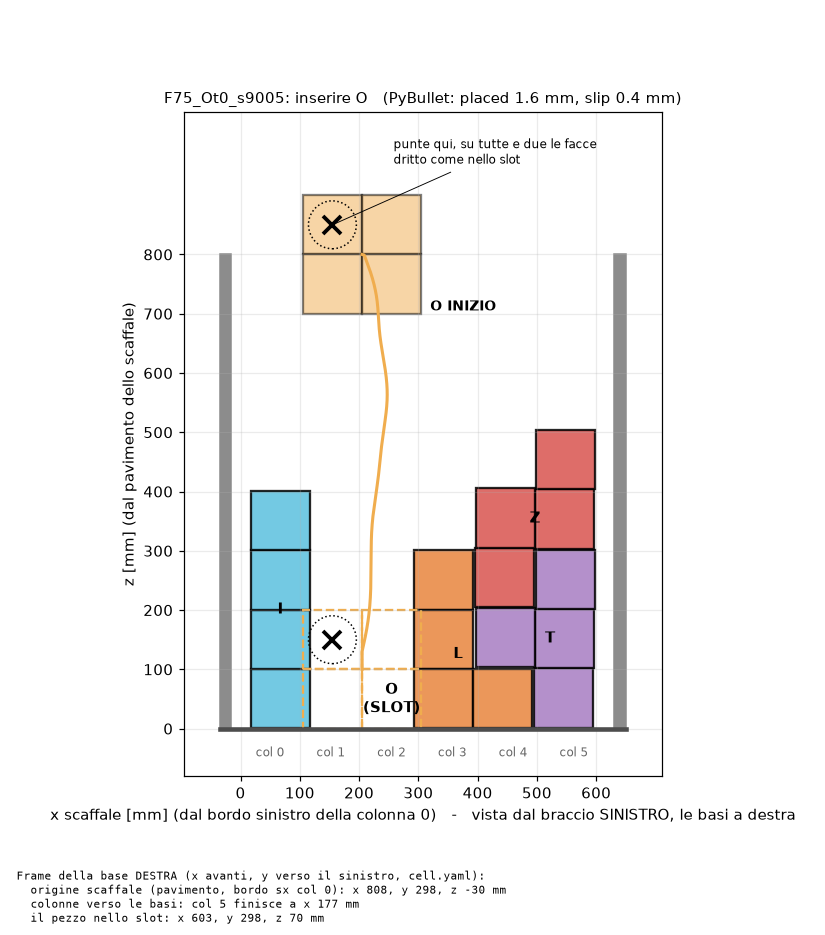
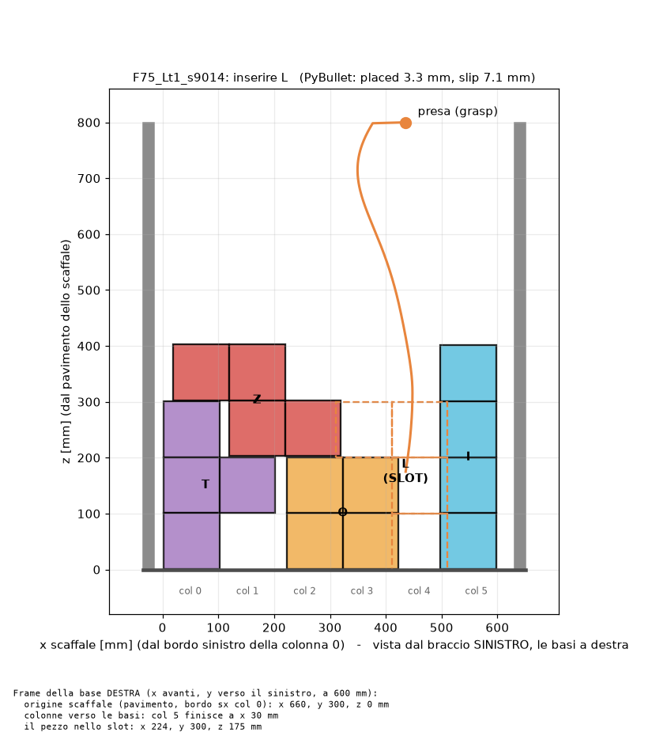
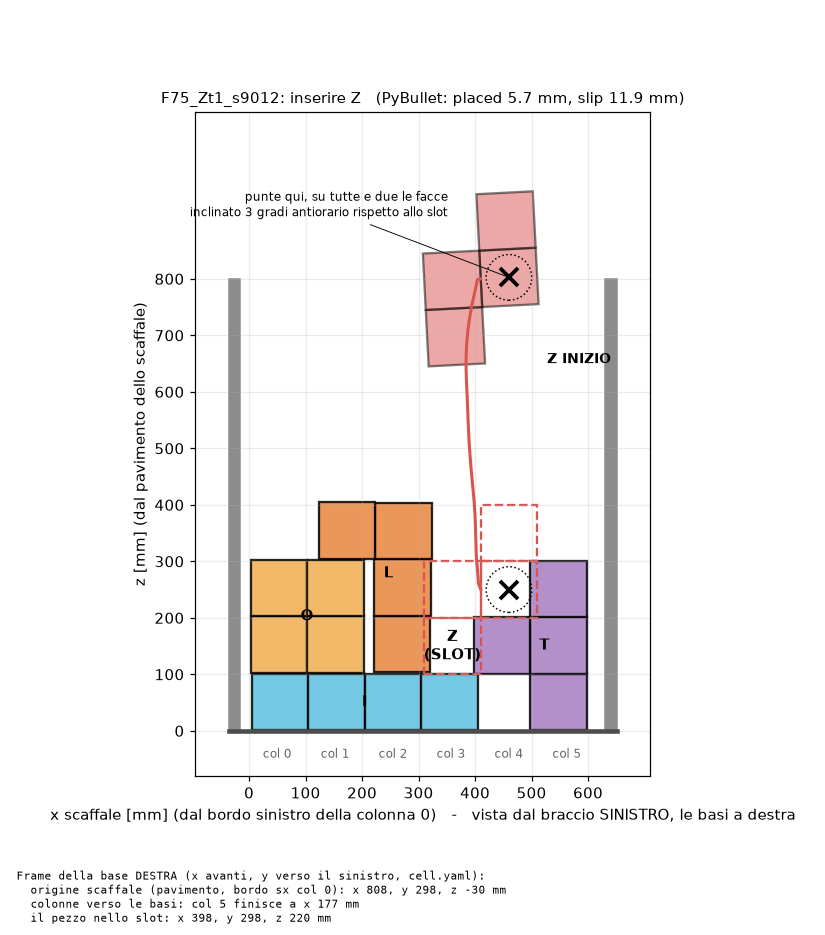
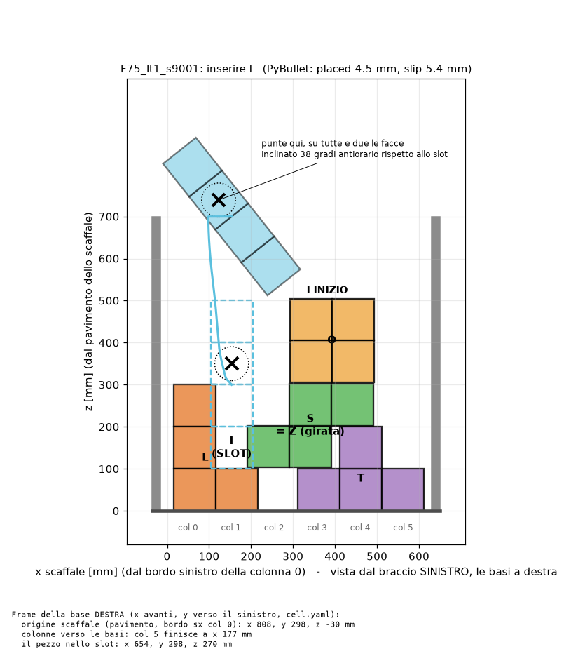

# Due Kinova: 5 esempi col kit da 5 pezzi

Kit: **I, O, T, L, Z**, ognuno fatto da 4 cubi di polistirolo da 10 cm (20 cubi in tutto).
Un pezzo piatto girato sul retro diventa il suo speculare: la **L girata fa la J**, la **Z
girata fa la S**. Le rotte sono `c100_five_cut800`: addestrate in PyBullet già a 100 mm, con
lo slot ristretto al 75%. Lo slot è ristretto perché i due vicini **entrano nello slot di
~12-18 mm per lato**: non vanno messi sulla griglia, ma dove dicono le quote qui sotto.

| # | mondo | si inserisce | vicini sullo scaffale | PyBullet placed / slip |
|---|---|---|---|---|
| 1 | `F75_Tt1_s9007` | T | I, O, Z, L | 4.6 / 1.2 mm |
| 2 | `F75_Ot0_s9005` | O | L, I, T, Z | 1.6 / 0.4 mm |
| 3 | `F75_Lt1_s9014` | L | O, T, Z, I | 3.3 / 7.1 mm |
| 4 | `F75_Zt1_s9012` | Z | I, T, O, L | 5.7 / 11.9 mm |
| 5 | `F75_It1_s9001` | I | L, T, S (= Z girata), O | 4.5 / 5.1 mm |

Partire dal **1** (T): è quello già provato oggi a braccio singolo.

---

## La cella

```
            vista dall'alto, frame della base DESTRA (x avanti, y a sinistra)

     y
     ^
 600 |  [base SINISTRA .200]  ->  tool guarda -y
     |
 300 |  ====================== scaffale (piano x-z) ======================
     |  x=30 (col 5)                                        x=660 (col 0)
     |
   0 |  [base DESTRA .107]    ->  tool guarda +y
     +--------------------------------------------------------------------> x
        0                                                  660 mm
```

- Le due basi sono **parallele** (stessa x in avanti, stessa altezza) e la sinistra sta a **y = +600 mm**.
- Lo scaffale è **centrato** fra le due basi (y = 300 mm). Il suo pavimento è **alla quota
  delle basi** (z = 0). Se è più alto o più basso, aggiungi `--lift <metri>` a tutti i comandi
  (positivo = più in alto).
- L'origine dello scaffale (pavimento, bordo sinistro della colonna 0) è a **x = 660 mm**
  davanti alle basi, uguale per tutti e 5 i mondi (`--shelf-x 0.66`). Le colonne vanno
  **verso le basi**: la col 0 è la più lontana, la col 5 finisce a x = 30 mm.
- Le figure sono **viste dal braccio sinistro**: la col 0 a sinistra, le basi a destra.
- Il pezzo è spesso 100 mm (in y). Le punte degli end effector stanno a ±50 mm dal piano
  centrale dello scaffale quando stringono (`--gap 0.10`), a ±100 mm con `--gap 0.20`.

I vicini sono in polistirolo e alcuni sono spostati fuori griglia: **fissali con biadesivo o
nastro**, altrimenti scivolano alla prima spinta.

---

## Ogni sessione: 4 terminali

**T1 - braccio destro (.107)** (terminale normale, SENZA `env.sh`):

```bash
source /opt/ros/jazzy/setup.bash && source ~/ros2_ws/install/setup.bash && ros2 run kinova_control kinova_controller.py --ip 192.180.0.107 --ros-args -r __ns:=/right -p initial_mode:=cartesian -p home_on_start:=true -p ee_frame:=end_effector_link -p urdf_path:=$HOME/lorenzo/gen3_bare.urdf -p friction_enable:=true -p friction_urdf_path:=$HOME/lorenzo/gen3_bare.urdf -p kalman_enable:=true -p cart_k:='[600.0, 600.0, 600.0, 20.0, 20.0, 20.0]' -p cart_d:='[5.0, 5.0, 5.0, 1.0, 1.0, 1.0]'
```

**T2 - braccio sinistro (.200)** (terminale normale, SENZA `env.sh`):

```bash
source /opt/ros/jazzy/setup.bash && source ~/ros2_ws/install/setup.bash && ros2 run kinova_control kinova_controller.py --ip 192.180.0.200 --ros-args -r __ns:=/left -p initial_mode:=cartesian -p home_on_start:=true -p ee_frame:=end_effector_link -p urdf_path:=$HOME/lorenzo/gen3_bare.urdf -p friction_enable:=true -p friction_urdf_path:=$HOME/lorenzo/gen3_bare.urdf -p kalman_enable:=true -p cart_k:='[600.0, 600.0, 600.0, 20.0, 20.0, 20.0]' -p cart_d:='[5.0, 5.0, 5.0, 1.0, 1.0, 1.0]'
```

Aspetta che entrambi siano in home e fermi. Per spegnere un braccio: Ctrl-C nel suo terminale.

**T3 - registra tutto, dall'inizio alla fine** (Ctrl-C per chiudere):

```bash
source ~/lorenzo/env.sh && mkdir -p ~/lorenzo/bags && cd ~/lorenzo/bags && ros2 bag record -e "/(left|right)/.*" -o sessione_$(date +%m%d_%H%M)
```

**T4 - i nostri script**:

```bash
source ~/lorenzo/env.sh && cd "$LORENZO/ws/src/kinova_dual_arm_dmp_insertion" && git pull
```

Controlli veloci prima di muovere (in T4):

```bash
ping -c 3 192.180.0.200 && ping -c 3 192.180.0.107
```

```bash
ros2 topic hz /left/joint_states
```

```bash
ros2 topic hz /right/estimated_wrench
```

Il rumore della forza da fermo (10 s, braccio fermo, niente che tocca; Ctrl-C per finire):

```bash
ros2 service call /left/zero_wrench std_srvs/srv/Trigger && ros2 topic echo /left/estimated_wrench --field wrench.force
```

---

## Per ogni mondo: la scala dei test

Per ogni esempio, in ordine, e si passa al gradino dopo solo se quello prima è andato bene.
`W` = il nome del mondo: copia la riga dalla sezione dell'esempio.

| gradino | cosa | board montata? | pezzo in mano? |
|---|---|---|---|
| a | `--dry`: stampa il piano, non muove niente | - | no |
| b | mani vuote, in aria, punte a 20 cm, 10 cm più in alto | no | no |
| c | mani vuote, punte a 20 cm, quota vera | sì | no |
| d | mani vuote, punte a 10 cm (= la presa) | sì | no |
| e | `check`: insert completo senza robot | - | - |
| f | `insert` completo, 3 volte più lento | sì | sì |

I comandi sono gli stessi per tutti, cambia solo `W`:

```bash
W=F75_Tt1_s9007
```

a.
```bash
python -m kinova_dual_arm_dmp_insertion.follow_two_arms $W --shelf-x 0.66 --gap 0.20 --dry
```

b.
```bash
python -m kinova_dual_arm_dmp_insertion.follow_two_arms $W --shelf-x 0.66 --gap 0.20 --lift 0.10
```

c.
```bash
python -m kinova_dual_arm_dmp_insertion.follow_two_arms $W --shelf-x 0.66 --gap 0.20
```

d.
```bash
python -m kinova_dual_arm_dmp_insertion.follow_two_arms $W --shelf-x 0.66 --gap 0.10
```

e.
```bash
python -m kinova_dual_arm_dmp_insertion.main check $W --arm c100_five_cut800 --sep 0.60 --shelf-x 0.66 --slow 3
```

f. Prima rilancia T1 e T2 con la rigidezza per cui la rotta è addestrata (quella che stampa
`check`, `[1500, 1500, 1500, 8, 40, 8]`): Ctrl-C in T1 e T2, poi incolla questi. Se preferisci
salire per gradi da 600, cambia solo i numeri di `cart_k`.

T1 - destro (.107):
```bash
source /opt/ros/jazzy/setup.bash && source ~/ros2_ws/install/setup.bash && ros2 run kinova_control kinova_controller.py --ip 192.180.0.107 --ros-args -r __ns:=/right -p initial_mode:=cartesian -p home_on_start:=true -p ee_frame:=end_effector_link -p urdf_path:=$HOME/lorenzo/gen3_bare.urdf -p friction_enable:=true -p friction_urdf_path:=$HOME/lorenzo/gen3_bare.urdf -p kalman_enable:=true -p cart_k:='[1500.0, 1500.0, 1500.0, 8.0, 40.0, 8.0]' -p cart_d:='[5.0, 5.0, 5.0, 1.0, 1.0, 1.0]'
```

T2 - sinistro (.200):
```bash
source /opt/ros/jazzy/setup.bash && source ~/ros2_ws/install/setup.bash && ros2 run kinova_control kinova_controller.py --ip 192.180.0.200 --ros-args -r __ns:=/left -p initial_mode:=cartesian -p home_on_start:=true -p ee_frame:=end_effector_link -p urdf_path:=$HOME/lorenzo/gen3_bare.urdf -p friction_enable:=true -p friction_urdf_path:=$HOME/lorenzo/gen3_bare.urdf -p kalman_enable:=true -p cart_k:='[1500.0, 1500.0, 1500.0, 8.0, 40.0, 8.0]' -p cart_d:='[5.0, 5.0, 5.0, 1.0, 1.0, 1.0]'
```

Aspetta che siano tutti e due in home e fermi, poi in T4:
```bash
python -m kinova_dual_arm_dmp_insertion.main insert $W --arm c100_five_cut800 --sep 0.60 --shelf-x 0.66 --slow 3
```

`--gap` è la distanza fra le punte (le due facce di spugna che si guardano): 0.20 per i primi
giri, 0.10 è la larghezza del pezzo. Nel codice: `GAP` in `follow_two_arms.py`.

Per rifare le figure e le quote (anche dopo aver cambiato `--shelf-x` o `--lift`):

```bash
python -m kinova_dual_arm_dmp_insertion.board $W --sep 0.60 --shelf-x 0.66
```

---

## 1. T - `F75_Tt1_s9007`

```bash
W=F75_Tt1_s9007
```


Quote di ogni pezzo nel frame dello scaffale (x dal bordo sinistro della col 0, z dal pavimento):

| pezzo | x [mm] | z [mm] |
|---|---|---|
| I | 5 .. 405 | 0 .. 100 |
| O | 412 .. 612 | 0 .. 200 |
| Z | 293 .. 493 | 103 .. 403 |
| L | 18 .. 218 | 103 .. 403 |
| **T (slot)** | 106 .. 306 | 100 .. 400 |

Nella base destra il pezzo finisce a x 429, y 300, z 250 mm.

## 2. O - `F75_Ot0_s9005`

```bash
W=F75_Ot0_s9005
```



| pezzo | x [mm] | z [mm] |
|---|---|---|
| L | 293 .. 493 | 0 .. 300 |
| I | 18 .. 118 | 0 .. 400 |
| T | 397 .. 599 | 0 .. 300 |
| Z | 395 .. 599 | 205 .. 504 |
| **O (slot)** | 105 .. 305 | 0 .. 200 |

Nella base destra il pezzo finisce a x 455, y 300, z 100 mm (il più basso dei cinque:
le punte passano a 10 cm dal tavolo).

## 3. L - `F75_Lt1_s9014`

```bash
W=F75_Lt1_s9014
```



| pezzo | x [mm] | z [mm] |
|---|---|---|
| O | 223 .. 423 | 0 .. 200 |
| T | 2 .. 202 | 0 .. 300 |
| Z | 19 .. 319 | 203 .. 403 |
| I | 498 .. 598 | 0 .. 400 |
| **L (slot)** | 311 .. 511 | 0 .. 300 |

Nella base destra il pezzo finisce a x 224, y 300, z 175 mm (vicino alle basi).

## 4. Z - `F75_Zt1_s9012`

```bash
W=F75_Zt1_s9012
```



| pezzo | x [mm] | z [mm] |
|---|---|---|
| I | 5 .. 405 | 0 .. 100 |
| T | 397 .. 597 | 0 .. 300 |
| O | 3 .. 203 | 103 .. 303 |
| L | 123 .. 323 | 104 .. 405 |
| **Z (slot)** | 310 .. 510 | 100 .. 400 |

Nella base destra il pezzo finisce a x 250, y 300, z 250 mm. Slip in PyBullet 11.9 mm: è il
più delicato dei cinque.

## 5. I - `F75_It1_s9001`

```bash
W=F75_It1_s9001
```



| pezzo | x [mm] | z [mm] |
|---|---|---|
| L | 16 .. 216 | 0 .. 300 |
| T | 311 .. 611 | 0 .. 200 |
| S = **Z girata** | 191 .. 491 | 103 .. 303 |
| O | 292 .. 493 | 305 .. 505 |
| **I (slot)** | 104 .. 204 | 100 .. 500 |

Nella base destra il pezzo finisce a x 506, y 300, z 300 mm. È il più lontano dei cinque:
821 mm dalla spalla (il limite è 902). **Al gradino b usa `--lift 0.0`**: con `--lift 0.10`
arriva a 882 mm, il braccio quasi disteso.

---

## Cosa portarsi a casa da ogni prova

- `logs/follow2_<mondo>_<ora>.csv`: comando e misura delle due flange, errore, forze, distanza
  flangia-flangia (gradini b-d).
- `logs/<mondo>_c100_five_cut800_<ora>.csv`: l'insert, un tick ogni 10 ms (gradino f).
- `~/lorenzo/bags/sessione_*`: tutto quello che pubblicano i due controller.
- **A mano**: dopo `insert`, misura la cella peggiore del pezzo rispetto al suo posto (mm) e
  scrivila qui sotto. Il robot non lo vede.

| data | mondo | gradino | esito | placed [mm] | note |
|---|---|---|---|---|---|
| | | | | | |

Per copiarli sul tuo PC (da un terminale del tuo PC):

```bash
scp -r nvidia@<ip-pc-robot>:~/lorenzo/ws/src/kinova_dual_arm_dmp_insertion/logs ./logs_robot
```

---

## Da sapere

- **Pezzi leggeri** (60-120 g): pesane uno e scrivilo in `config/cell.yaml`, `piece_mass`.
  L'appoggio "a sentire" scatta al 60% del peso, cioè circa 0.5 N. Se il rumore della forza
  stimata è più alto (lo stampa già il gradino b), quella parte non è affidabile: il resto sì.
- Le posizioni sono **nominali**: le basi parallele a 600 mm e lo scaffale dove è scritto
  sopra. Se le cose non tornano (le punte non sono dove ti aspetti rispetto ai pezzi), la
  soluzione è `calibrate_cell.py`, poi senza `--sep` / con `--cell`.
- Non c'è un controllo di collisione fra gli avambracci: per questo si passa dai gradini b-d.
